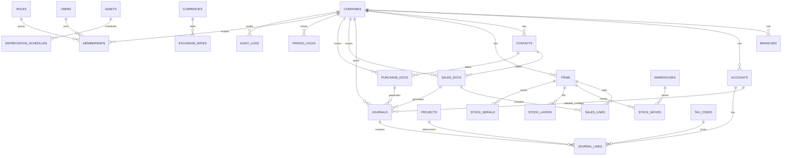

# ERD Backend — Nalbook

> Skema logis per-tenant (satu database PostgreSQL per tenant). Implementasi: [TRD](./trd.md). Aturan bisnis: [PRD](./prd.md).
> Uang: `NUMERIC(19,4)`. Tidak pernah float. Semua tabel transaksional memuat `company_id` (+ `branch_id` bila relevan).

## 1. Diagram (Mermaid)

## 2. Tabel Inti

### 2.1 Organisasi & akses

| Tabel | Kolom kunci | Constraint |
|---|---|---|
| `companies` | `id, code, name, base_currency, coa_template, created_at` | `code` unik per DB tenant |
| `branches` | `id, company_id→companies, code, name` | `UNIQUE(company_id, code)` |
| `warehouses` | `id, company_id, branch_id→branches, code, name` | `UNIQUE(company_id, code)` |
| `users` | `id, email UNIQUE, password_hash, totp_secret NULL, sso_subject NULL, locked_until` | email unik global di control-plane |
| `roles` | `id, company_id, name, is_system` | `UNIQUE(company_id, name)` |
| `permissions` | `id, role_id→roles, module, action` | `UNIQUE(role_id, module, action)`; module × action sesuai PRD §3 |
| `memberships` | `id, user_id, company_id, role_id→roles, expires_at NULL, scope_branch_id NULL` | konsultan: `expires_at` wajib; index `(user_id, company_id)` |
| `sessions` | `id, user_id, refresh_hash, ip, user_agent, revoked_at NULL, expires_at` | revoke = set `revoked_at` |
| `document_sequences` | `company_id, doc_type, last_no` | `PK(company_id, doc_type)`; update `FOR UPDATE` |
| `period_locks` | `company_id, period_start, period_end, is_closed, closed_by, closed_at, reason` | tulis ke periode closed ditolak app-level |
| `schema_migrations` | `version, applied_at` | versi migrasi per DB tenant |

### 2.2 Akuntansi inti

| Tabel | Kolom kunci | Constraint |
|---|---|---|
| `accounts` | `id, company_id, parent_id NULL→accounts, code, name, type (aset/kewajiban/ekuitas/pendapatan/beban), is_postable, opening_balance NUMERIC` | `UNIQUE(company_id, code)`; induk tidak postable |
| `journals` | `id, company_id, branch_id, date, posting_date, doc_type, doc_id, memo, status (draft/posted/voided), created_by` | `posted` immutable; index `(company_id, date)` |
| `journal_lines` | `id, journal_id→journals, account_id→accounts, debit NUMERIC, credit NUMERIC, currency, exchange_rate, rate_date, rate_source, tax_code_id NULL, project_id NULL, department_id NULL, cost_center_id NULL, memo` | `CHECK(debit>=0 AND credit>=0 AND NOT(debit>0 AND credit>0))`; total per jurnal seimbang (cek app + test) |
| `tax_codes` | `id, company_id, code, kind (PPN_OUT/PPN_IN/PPh21/23/42), rate NUMERIC, config JSONB` | tarif sebagai config (tanpa redeploy) |
| `projects` | `id, company_id, code, name, status` | — |
| `departments` | `id, company_id, code, name` | — |
| `attachments` | `id, company_id, s3_key, filename, mime, size, sha256` | file terenkripsi at-rest |

### 2.3 Jual / beli / kontak

| Tabel | Kolom kunci |
|---|---|
| `contacts` | `id, company_id, kind (customer/supplier), code UNIQUE, name, npwp_encrypted, address, credit_limit NUMERIC, payment_term_days, UNIQUE(company_id, code)` |
| `sales_docs` | `id, company_id, branch_id, doc_type (quote/order/delivery/invoice/retur/dp), doc_no, contact_id→contacts, date, due_date, currency, exchange_rate, status, total NUMERIC, UNIQUE(company_id, doc_type, doc_no)` |
| `sales_lines` | `id, sales_doc_id→sales_docs, item_id NULL→items, qty NUMERIC, price NUMERIC, discount NUMERIC, tax_code_id NULL→tax_codes, amount NUMERIC` |
| `purchase_docs` / `purchase_lines` | mirror sisi beli (request/order/grn/invoice/retur/payment) |
| `allocations` | `id, company_id, doc_id, payment_id, amount NUMERIC` (alokasi bayar → piutang/hutang, FIFO default) |

### 2.4 Kas, persediaan, aset

| Tabel | Kolom kunci |
|---|---|
| `cash_accounts` | `id, company_id, code, name, account_id→accounts` (kas/bank) |
| `cash_moves` | `id, company_id, cash_account_id, kind (in/out/transfer), amount, journal_id→journals, statement_ref NULL` |
| `bank_statements` | `id, company_id, cash_account_id, date, amount, description, matched_move_id NULL` (rekonsiliasi) |
| `items` | `id, company_id, sku UNIQUE, name, costing (fifo/average), units JSONB, avg_cost NUMERIC, min_stock` |
| `stock_moves` | `id, company_id, warehouse_id→warehouses, item_id→items, qty, kind (in/out/transfer/opname), journal_id NULL, doc_ref` |
| `stock_layers` | `id, company_id, warehouse_id, item_id, qty_remaining, unit_cost` (lapisan FIFO) |
| `stock_serials` | `id, company_id, item_id, serial_or_batch, warehouse_id, status` |
| `assets` | `id, company_id, code, category_id, name, acquired_date, cost NUMERIC, method (straight/declining), useful_life_months, book_value NUMERIC` |
| `depreciation_schedules` | `id, asset_id→assets, period, amount NUMERIC, journal_id NULL, UNIQUE(asset_id, period)` (idempoten worker) |

### 2.5 Anggaran, produksi, payroll, kurs

| Tabel | Kolom kunci |
|---|---|
| `budgets` | `id, company_id, account_id→accounts, period_start, period_end, department_id NULL, project_id NULL, amount NUMERIC` |
| `boms` | `id, company_id, item_id→items (barang jadi), version, lines JSONB` |
| `work_orders` | `id, company_id, bom_id→boms, qty_planned, qty_done, status, labor_cost NUMERIC, journal_id NULL` |
| `employees` | `id, company_id, code UNIQUE, name, npwp_encrypted, salary_encrypted, bank_account_encrypted` |
| `payroll_runs` | `id, company_id, period, lines JSONB, pph21 NUMERIC, journal_id NULL, slip_template` |
| `currencies` | `code PK (IDR/USD/…), name` |
| `exchange_rates` | `currency, rate_date, rate NUMERIC, source, PRIMARY KEY(currency, rate_date)` (riwayat, bukan dummy) |
| `fx_revaluations` | `id, company_id, period, amount NUMERIC, journal_id→journals` |

### 2.6 Integrasi, import, audit

| Tabel | Kolom kunci |
|---|---|
| `api_keys` | `id, company_id, name, key_hash, scopes JSONB, rate_limit, revoked_at NULL` |
| `webhook_subscriptions` | `id, company_id, url, secret_encrypted, events TEXT[], active` |
| `webhook_deliveries` | `id, subscription_id, event, payload JSONB, status_code NULL, attempts, next_retry_at NULL` |
| `import_batches` | `id, company_id, kind, filename, s3_key, status, error_report JSONB` |
| `export_jobs` | `id, company_id, report_key, params JSONB, s3_key NULL, status` |
| `audit_logs` | `id, company_id, user_id, action, module, document_id NULL, old_values JSONB, new_values JSONB, occurred_at, ip, user_agent` — **append-only** (`REVOKE UPDATE, DELETE`) |

## 3. Aturan Relasi & Indeks

- Semua FK `ON DELETE RESTRICT` untuk dokumen posted; hapus fisik dilarang — gunakan `voided` + jurnal pembalik.
- Indeks: `journals(company_id, date)`, `journal_lines(account_id, journal_id)`, `sales_docs(contact_id, due_date)` (aging), `stock_moves(warehouse_id, item_id)`, `audit_logs(company_id, occurred_at)`.
- Enkripsi kolom: `*_encrypted` = AES-GCM envelope via KMS; kunci terpisah dari data (TRD §5).
- Retensi: soft-delete `deleted_at` + purge job terotorisasi saja (PRD §7).
